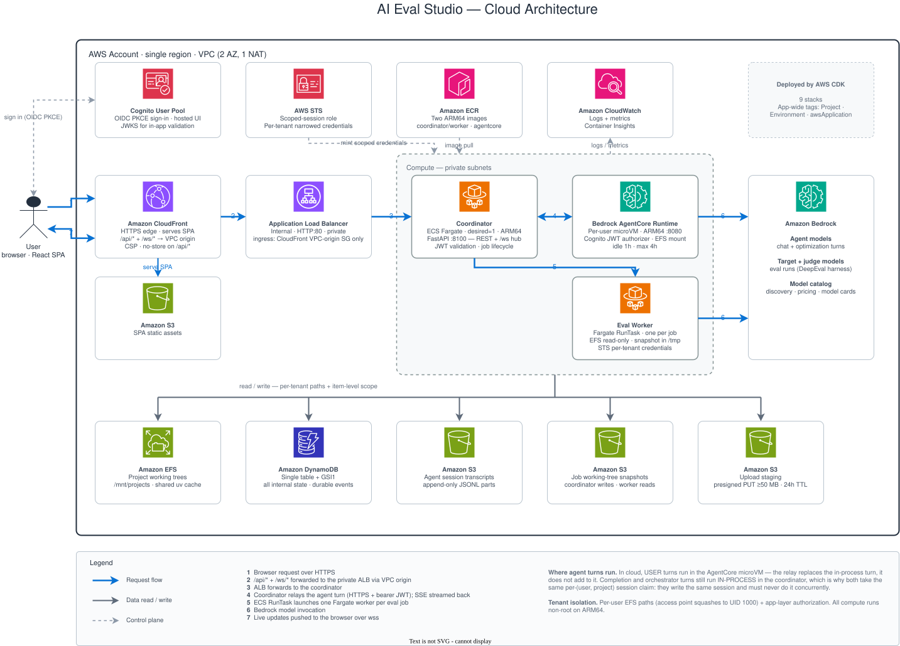

# AI Eval Studio

An end-to-end LLM evaluation platform. Upload a dataset, describe your goal in chat,
and the system runs evaluations across models, optimizes the prompt iteratively against
real failures, and hands you back a standalone Python eval harness you can run in CI.

Every model call — the agent driving the conversation, the models under test, and the
LLM judge — runs on Amazon Bedrock.

> **This project is a prototype for demonstration, not for production use.** Before
> using it with real data or real users, do your own independent assessment against
> your security and quality standards. [`SECURITY.md`](SECURITY.md) lists what the
> default deployment does and does not do, and the steps to take it to production.

## What it does

You talk to a coordinator agent, which walks the project through seven phases:

| Phase | What happens |
|---|---|
| 1. Data analysis | Profiles your uploaded CSV/Excel and proposes field mappings |
| 2. Configuration | Picks candidate models on a cost-quality frontier and chooses metrics |
| 3. Eval harness | Generates a standalone DeepEval harness and validates it runs |
| 4. Baseline prompt | Drafts the prompt to optimize from |
| 5. Confirm & run | Measures a real baseline across the candidate pool |
| 6. Eval + optimize | Iterates prompt edits against failures until scores converge |
| 7. Report | Produces a cost/quality report and a recommended model + prompt |

The generated harness is the durable artifact: a self-contained Python project that
runs without the platform. See
[`backend/app/templates/harness/README.md`](backend/app/templates/harness/README.md).

## Architecture

The platform runs in two modes from one codebase, selected by `EVAL_STUDIO_MODE`:

- **`dev`** — everything in one FastAPI process on your machine, projects on local disk.
- **`cloud`** — a Fargate coordinator behind CloudFront; agent turns run in a per-user
  Bedrock AgentCore microVM, and each eval job runs as its own Fargate task.

[](docs/diagrams/architecture-overview.svg)

<sub>Click to view full size. Editable source:
[`architecture-overview.drawio`](docs/diagrams/architecture-overview.drawio) (draw.io).</sub>

**Components**

- **Frontend** — React 19 + Vite + TypeScript, shadcn/ui + Tailwind, assistant-ui for chat.
- **Backend** — FastAPI wrapping the Claude Agent SDK. One WebSocket (`/ws`) carries
  chat, job, and project events.
- **Eval engine** — DeepEval, with three distinct model roles: the agent model, the
  target models under test, and the judge model for LLM-as-a-judge metrics.
- **Prompt optimization** — failure-driven and targeted-minimal-diff: read the eval
  result (passing exemplars, failed-case digest, regression diff) and make the smallest
  change that addresses the dominant failure pattern.
- **Storage** — dev keeps each project as a self-contained directory; cloud puts working
  trees on EFS, state in DynamoDB, and transcripts/snapshots in S3.

## Running locally

**Prerequisites** — Python 3.11+, [uv](https://docs.astral.sh/uv/), Node.js 22+, `git`,
and AWS credentials.

**Anthropic models need a one-time use-case form.** Bedrock enables its serverless
models automatically, but each account must submit Anthropic's first-time-use form
before the first call to a Claude model; submitting it from an organization's
management account covers its member accounts. The coordinator agent runs on
Claude, so submit the form before the first chat. See
[Access Amazon Bedrock foundation models](https://docs.aws.amazon.com/bedrock/latest/userguide/model-access.html).

> **The local agent runs shell commands on your machine without confirmation.**
> The coordinator writes and executes an evaluation harness, and its `Bash` tool
> is not sandboxed or path-restricted — it runs with your user's privileges. Run
> it on a machine where that is acceptable.

```bash
(cd backend  && uv sync)
(cd frontend && npm install)
```

```bash
./scripts/start.sh   # starts backend on :8100 and frontend on :3100
./scripts/stop.sh
```

Then open <http://localhost:3100>. `start.sh` exports `CLAUDE_CODE_USE_BEDROCK=1`, which
the Agent SDK requires.

Both processes log to the terminal and append to `.dev-logs/backend.log` and
`.dev-logs/frontend.log` (gitignored), so a failure stays readable by someone who
wasn't at the keyboard when it happened.

## Deploying to AWS

The cloud deployment is AWS CDK (Python) across nine stacks — networking, storage, auth,
IAM, observability, compute, frontend, AgentCore, and an AppRegistry application.

- [`infra/README.md`](infra/README.md) — CDK prerequisites, synth, and the
  deploy/iterate workflow.
- [`docs/runbooks/deploy.md`](docs/runbooks/deploy.md) — first full cloud deploy,
  start to finish.
- [`docs/runbooks/teardown.md`](docs/runbooks/teardown.md) — full teardown.

The deployed entry point is the CloudFront URL; the ALB is internal and not reachable
from the internet. Sign-in is Cognito hosted UI (OIDC + PKCE). The default deployment is
a development deployment; [`SECURITY.md`](SECURITY.md) lists the steps to take it to
production.

## Security scope

**Treat one deployment as a single trust domain.** Everyone you onboard can reach
everyone else's data. The platform is multi-user — Cognito sign-in, per-user projects —
and every API route and agent tool call checks ownership before it
answers, but an application-layer check is not a boundary the agent itself is confined
by: the product generates and runs code, with a shell, by design.

Three specific gaps, named rather than summarised, because "app-layer isolation only"
reads as vaguer than the truth:

- **Project files are not fenced at all.** Every working tree sits under one EFS access
  point that squashes all access to a single POSIX identity, so there is no per-user
  permission to enforce. `Write`, `Edit` and `NotebookEdit` are path-jailed to the
  project directory, and tool calls are pinned to the project the conversation is about
  — but `Bash` reads `/mnt/projects` directly and passes through neither. That is
  deliberate: a static scan of a command line cannot contain `..`, `$VAR` or `$(...)`,
  so scanning it would assert a guarantee it does not deliver
  ([`agent_runner.py`](backend/app/services/agent_runner.py)). **Uploaded datasets,
  prompts, generated harnesses and reports all live here** — the one layer with no IAM
  surface.
- **Chat transcripts are scoped by a credential that can be re-minted for anyone.** Each
  turn runs on STS credentials narrowed to one user's S3 prefix, so the AWS API rejects
  a cross-tenant read. But the role that mints them can ask for any tenant's tag: IAM
  has no condition key binding a session tag's *value* to the requester, so the trust
  policy can only require that a tag is present
  ([`iam_stack.py`](infra/cdk/iam_stack.py)).
- **Execution metadata is readable across tenants.** Job records, events and locks in
  DynamoDB are reached with the runtime's own credentials, which are cross-tenant
  because resolving an ownership check reads other owners' records by definition.

The second can be closed with `AssumeRoleWithWebIdentity`, carrying the tenant tag in
a claim inside the Cognito ID token so STS verifies it and the caller stops asserting it.
The first needs per-session filesystem storage instead of a shared mount; AgentCore
offers one and it is in preview. **The first is what multi-tenant use actually depends
on**, and it is not done.

Two related properties are deliberate rather than oversights:

- **Self-signup is disabled.** An administrator creates each user.
- **The platform runs code an LLM wrote** — generating and executing an eval harness is
  the product, not a side effect. The worker task role therefore carries no ambient S3
  or DynamoDB grant; it reaches both only through the narrowed credential it mints for
  that one job.

## Tests and checks

```bash
(cd backend  && uv run pytest)      # backend suite
(cd frontend && npm test)           # frontend suite (vitest)
(cd frontend && npm run build)      # eslint + tsc + vite build
./scripts/lint.sh                   # ruff over backend/, infra/, scripts/
./scripts/test-infra.sh             # CDK synth-level tests (see note)
```

The infra tests need a runner because they sit between two virtualenvs: they
import `aws_cdk` (installed in `infra/.venv`) and are collected by pytest
(installed in `backend/.venv`). `test-infra.sh` puts the former on `PYTHONPATH`
for the latter, so neither venv has to duplicate the other's dependencies.

Tests marked `integration` hit real external services and are skipped by default; run
them with `uv run pytest -m integration`.

## Repository layout

```
├── frontend/            # React 19 + Vite + TypeScript
├── backend/
│   └── app/
│       ├── api/         # Route handlers (chat, eval, projects, upload, ws)
│       ├── agents/      # Subagent definitions
│       ├── prompts/     # Coordinator + subagent system prompts (markdown)
│       ├── models/      # Pydantic schemas
│       ├── platform/    # dev vs cloud adapters (storage, auth, compute)
│       ├── services/    # Core logic (agent runner, jobs, reports, MCP tools)
│       └── templates/   # Standalone eval harness template
├── infra/               # AWS CDK app (nine stacks)
├── scripts/             # start.sh, stop.sh, lint.sh, test-infra.sh
├── projects/            # User eval projects (gitignored)
└── docs/                # Runbooks, diagrams, reference
```

## Documentation

| Doc | What it covers |
|---|---|
| [`SECURITY.md`](SECURITY.md) | Reporting a vulnerability; path to production |
| [`infra/README.md`](infra/README.md) | CDK layout, prerequisites, deploy/iterate loop |
| [`docs/runbooks/deploy.md`](docs/runbooks/deploy.md) | First cloud deploy, step by step |
| [`docs/runbooks/teardown.md`](docs/runbooks/teardown.md) | Full teardown |
| [`docs/error-codes.md`](docs/error-codes.md) | Stable `ResourceError.code` catalog |
| [`docs/naming-conventions.md`](docs/naming-conventions.md) | File and symbol naming rules |
| [`docs/frontend-design-system.md`](docs/frontend-design-system.md) | Theming tokens and the no-hardcoded-color rule |
| [`docs/diagrams/`](docs/diagrams/) | Cloud architecture diagram |

## License

This project is licensed under the Apache-2.0 License. See [`LICENSE`](LICENSE),
[`NOTICE`](NOTICE) and [`THIRD-PARTY-LICENSES`](THIRD-PARTY-LICENSES).

### Claude Code

This project depends on the Claude Code CLI, which is proprietary to Anthropic PBC
and not covered by this project's license. You must obtain and use it under
Anthropic's [Commercial Terms of Service](https://www.anthropic.com/legal/commercial-terms).

## Reporting a security issue

See [`SECURITY.md`](SECURITY.md) for how to report a potential security issue. Please do
not open a public issue.

Known limitations of the deployed system are stated in [Security scope](#security-scope)
above — read that before deploying this for more than one person.
